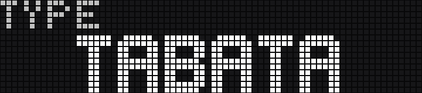

# Workout Timer for the BUSY Bar

An interval timer for the [BUSY Bar](https://busy.app). You set up and run your workout on the bar itself, with its wheel and buttons, and get a recap at the end.

The timer runs on the bar itself. Once it's installed, you only need the bar.

## Timer types

| Type | Work | Rest | Good for |
|---|---|---|---|
| **Tabata** | counts down | counts down | Classic intervals, such as 20 s work and 10 s rest, 8 rounds. |
| **Fixed rest** | counts up until you press OK | counts down | Strength sets: do your squats at your own pace, press OK, rest exactly 1:30. |
| **Fixed work** | counts down | counts up until you press OK | Timed efforts: hold a plank for 45 s, rest as long as you need, press OK for the next round. |

Each round is a work phase followed by a rest phase. Choose 1 to 99 rounds, or ∞ to keep going until you stop. A get-ready countdown comes first, unless you turn it off. The workout ends after the last work phase, with no rest after it.

## Install

You need a BUSY Bar with firmware 1.3.1 or later.

1. Download the `.tgz` file from the [latest release](https://github.com/teunbruijnen/busybar-workout-timer/releases/latest).
2. Connect the bar by USB and open http://10.0.4.20 in a browser, or open the bar's web interface over Wi-Fi.
3. On the **Apps** tab, click **Add app**, choose the file, click **Upload** and then **Install app**.

Start it from the bar's APPS menu.

To update: on the **Apps** tab, click the app, then **Update app**, choose the newer file, click **Upload** and then **Update app**.

The earlier Python version, `app.py`, still works. It runs on a computer, and section 8 of `SPEC.md` lists how it differs; the JavaScript app replaces it.

## Controls

| Button | Setting up | During a workout | Recap |
|---|---|---|---|
| **Wheel** | change the value, one step per click | – | turn the pages |
| **OK** | confirm, go to the next step | skip: end the phase now | next page |
| **START** | start the workout (on the summary) | pause / resume | run the same workout again |
| **BACK** | go back one step; on TYPE, close the timer | stop (press twice within 3 s) | back to TYPE |

## Set up a workout

1. **TYPE:** turn the wheel to TABATA, FIXED REST or FIXED WORK, and press OK.
2. **WORK:** set the minutes, press OK, set the seconds, press OK.
3. **REST:** the same.
4. **ROUNDS:** 1 to 99; turn below 1 for ∞. Press OK.
5. **Summary:** your workout in one line, such as `20/10 x8`. Press START.

Fixed rest has no WORK step, and Fixed work no REST step.

The part you're setting blinks, and stays lit while you turn the wheel. Both parts wrap around. Turning up from 59 minutes gives 0, and down from 0 gives 59. The seconds move by the Time step setting and stay within the minute: with a 5 s step, 1:55 turns up to 1:00. The shortest time is one step (0:05 with a 5 s step).

BACK steps back one part at a time: summary → ROUNDS → REST seconds → REST minutes → WORK seconds → WORK minutes → TYPE.

## During a workout

The screen shows the phase (WORK in green, REST in amber, READY in blue), the round below it (`3/8`, or `R12` for round 12 with ∞ rounds) and the time. A time that counts up starts with `+`. A countdown has a bar along the bottom that shrinks each second, and in its last 3 seconds the last digit blinks.

- **Skip:** OK ends the current phase at once, get-ready included. A phase that counts up runs until you skip it. A skip in the first half second after a phase ended by itself is ignored, so a late press doesn't skip the next phase too.
- **Pause:** START pauses and resumes. The screen turns grey and the time blinks. You can't skip while paused.
- **Stop:** BACK shows `STOP?`. Press BACK again within 3 s to stop and see the recap. OK or START cancels it and does its usual job. The timer keeps running meanwhile.

The timer uses the bar's own timer sounds: a tick on each of the last 3 seconds of a countdown, a short sound at every phase change, and a longer one when the workout is complete. Stopping is silent, except for a workout with ∞ rounds that's past get-ready, since stopping is how it ends. The bar's volume applies.

## Recap

The recap cycles through WORK, REST, ROUNDS and TOTAL, 3 s each, until you press OK or turn the wheel. TOTAL is work plus rest; get-ready and pauses don't count. A skipped work phase counts as a round; one cut short by stopping doesn't. The top right says `DONE`, or `STOPPED` if you stopped early.

OK and START are ignored for the first second, so a late press doesn't restart the workout.

## Settings

These are on the bar's own Setup page for the app, next to Start: close the timer (BACK on TYPE) to reach it. A change counts from the next start of the timer.

- **Get ready:** 0 (off) to 15 s. Default 5 s.
- **Sound:** on or off. Default on.
- **Time step:** 1, 5, 10 or 15 s. Default 5 s. How far one click moves the seconds, and the shortest time you can set.
- **Skip with:** OK or START. Default OK. The button that skips during a workout; the other one pauses.

These, and each type's own times and rounds, are saved on the bar and kept through updates.

## Good to know

- To close the timer, press BACK on TYPE. Holding BACK force-quits it from any screen.
- A short BACK press shows the bar's "Loading..." for a moment before the timer comes back. The bar does this; the timer can't prevent it.
- Starting a BUSY session on the bar during a workout closes the timer.

## For developers

[SPEC.md](SPEC.md) describes all behaviour; [CLAUDE.md](CLAUDE.md) covers the code, tests and tools. To build the app yourself: [js-app/README.md](js-app/README.md). What changed: [CHANGELOG.md](CHANGELOG.md).

## License

The code is MIT, see [LICENSE](LICENSE). You're free to use, change and share it. It's provided as is, without any warranty. Parts come from other MIT projects: see [NOTICE.md](NOTICE.md).

The three sounds in `js-app/src/sounds` are BUSY's own, © Flipper FZCO, under [CC BY-SA 4.0](https://creativecommons.org/licenses/by-sa/4.0/). See [NOTICE](js-app/src/resources/NOTICE.txt).
